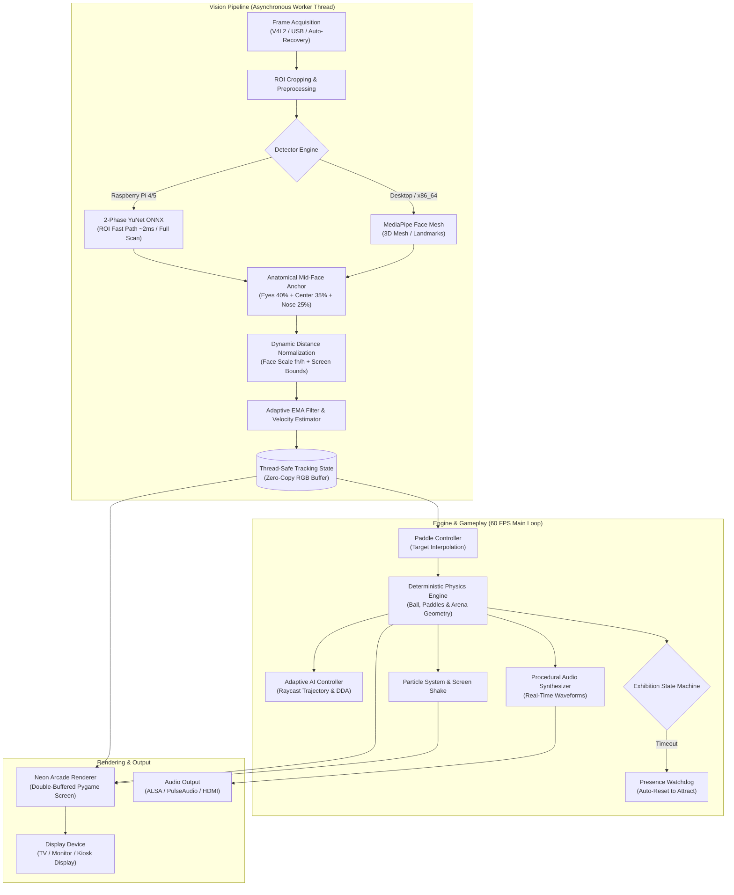
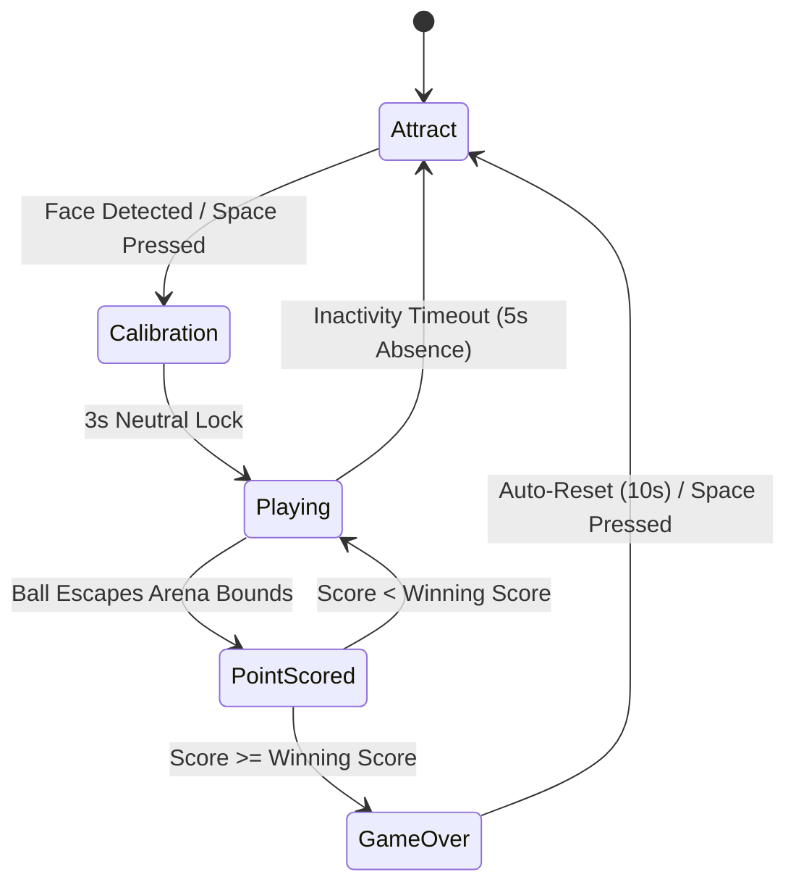

# FacePong

> High-performance contactless arcade Pong driven by real-time computer vision and adaptive artificial intelligence. Engineered for public exhibition kiosks, desktop workstations, and embedded single-board computers (Raspberry Pi 4 / 5).

[](https://www.python.org/)
[](LICENSE)
[]()
[]()
[](https://audacia.unisimon.edu.co/)

---

## Overview

**FacePong** is a hands-free, vision-controlled arcade experience developed for public exhibition spaces and interactive robotics showcases. Players maneuver their paddle purely through intuitive vertical head gestures and subtle nods. The opposing paddle is operated by an **Adaptive Dynamic Difficulty Adjustment (DDA)** artificial intelligence agent that continuously models shot trajectories, wall reflections, and human reaction latency to keep rallies challenging, exciting, and accessible.

To deliver flawless, latency-free tracking on resource-constrained embedded systems such as the **Raspberry Pi 4**, FacePong features an asynchronous, dual-threaded architecture with a **2-Phase Region-of-Interest (ROI) YuNet Deep Neural Network**, automatic screen/device profile standardization (`TV`, `LAPTOP`, `TABLET`, `AUTO`), and zero-allocation procedural audio.

---

## System Architecture

FacePong decouples camera frame acquisition and deep-learning inference from the 60 FPS deterministic physics and render loop using thread-safe synchronization:



---

## Key Engineering Innovations

### 1. 2-Phase YuNet ROI Tracking (Raspberry Pi Optimization)
Embedded ARM processors like the Broadcom BCM2711 (Raspberry Pi 4) lack hardware ARMv8 Cryptographic AES extensions, causing modern MediaPipe builds to crash on CPU instructions. FacePong solves this with OpenCV's deep-learning **YuNet ONNX model** using a 2-phase strategy:
- **Phase 1 (ROI Fast Path)**: Evaluates a tight padded crop (~70% padding) around the last known face position. Executes in **~1.5–3.0 ms**, reducing CPU consumption by over 80%.
- **Phase 2 (Full-Frame Fallback)**: If tracking drops, falls back to a downscaled (160×120) global scan in **~12–15 ms** to reacquire the face instantly.
- **Anatomical Mid-Face Anchor**: Fuses 40% glabella/eye midline, 35% bounding-box centroid, and 25% nose tip. Eliminates pitch deadzones and provides natural, direct response when looking up or down.

### 2. Screen & Distance Adaptive Sensitivity Profiles
Operating across diverse form factors (from living room smart TVs to desktop monitors and tablets) creates distinct optical challenges: sitting 2.5 meters away on a couch produces smaller camera pixel shifts than sitting 50 cm from a laptop.

FacePong standardizes travel sensitivity across setups:

| Profile | Target Environment | Spread ($\pm$) | Smoothing ($\alpha$) | Description |
| :--- | :--- | :--- | :--- | :--- |
| **`TV`** | Living room / Kiosks (1.5–3.5 m) | $\pm 0.060$ | `0.32` | Tight motion threshold; subtle head nods effortlessly cover full vertical court on large displays. |
| **`LAPTOP`** | Desk workstation (~50 cm) | $\pm 0.105$ | `0.26` | Balanced dynamic range for close-range desk usage. |
| **`TABLET`** | Handheld / Ultra-near (~30–40 cm) | $\pm 0.145$ | `0.22` | Wide range dampening micro-movements for handheld or tablet mounts. |
| **`AUTO`** | Universal (Default) | Dynamic | Dynamic | Automatically queries display resolution and scales spread inversely with physical face size ($f_h / h$). |

> **Interactive Toggle**: Press **`T`** at any point during execution to cycle profiles on the fly with instantaneous HUD feedback.

### 3. Predictive Raycasting & Dynamic Difficulty Adjustment (DDA)
The AI opponent evaluates incoming shots using multi-bounce geometric raycasting along arena boundaries. Rather than playing with superhuman perfection, the AI applies a calibrated error margin inversely proportional to shot difficulty:
- Routine, low-velocity serves are returned reliably to sustain engaging volleys.
- High-velocity angled cuts and edge deflections introduce human-like reaction delays and deflection spread, rewarding skilled player smashes.

### 4. Zero-Asset Procedural Audio & Real-Time Neon Shaders
- **Procedural Audio**: Real-time sound synthesis using NumPy sinusoidal and square waveform math. Generates classic arcade blips, wall reflections, goal explosions, and victory fanfares without external `.wav` or `.mp3` assets.
- **Zero-Allocation Rendering**: Pre-rendered bloom surfaces, cached PIP buffers, and geometry-bounded double-buffering eliminate garbage collection stalls during active rallies.

---

## Hardware & System Requirements

| Component | Minimum Specification | Recommended Specification |
| :--- | :--- | :--- |
| **Compute** | Raspberry Pi 4 Model B (4 GB RAM) | Raspberry Pi 5 / x86_64 Workstation |
| **Operating System** | Raspberry Pi OS 64-bit (Debian Bookworm) | Ubuntu 22.04+ / Debian 12 / macOS / Windows 11 |
| **Python** | 3.10 | 3.11+ |
| **Camera** | USB 2.0 UVC Webcam (V4L2 compatible) | 720p/1080p 30+ FPS Wide-Angle USB Camera |
| **Display** | 720p (1280×720) HDMI Monitor | 1080p (1920×1080) Television or Arcade Display |
| **Audio** | HDMI Audio / 3.5 mm Analog Out | HDMI Audio with external arcade speakers |

---

## Installation

### 1. Clone the Repository
```bash
git clone https://github.com/AndresRuzT/FacePong.git
cd FacePong
```

### 2. Set Up Virtual Environment
```bash
python3 -m venv .venv
source .venv/bin/activate
```

### 3. Install Dependencies
```bash
pip install --upgrade pip
pip install -r requirements.txt
```

---

## Usage & Command-Line Interface

### Standard Execution
Launch FacePong with automatic hardware detection and adaptive sensitivity:
```bash
python3 main.py
```

### TV / Exhibition Kiosk Mode
Launch in borderless fullscreen locked to the TV profile:
```bash
python3 main.py --fullscreen --profile TV
```

### Command-Line Arguments Reference

| Argument | Type | Default | Description |
| :--- | :--- | :--- | :--- |
| `--profile` | `choice` | `AUTO` | Sensitivity profile: `AUTO`, `TV`, `LAPTOP`, or `TABLET` |
| `--width` | `int` | `1280` | Target display resolution width in pixels |
| `--height` | `int` | `720` | Target display resolution height in pixels |
| `--fullscreen` | `flag` | `False` | Launch in borderless fullscreen mode |
| `--camera` | `int` | `None` | Camera device index override (auto-probes external USB first) |
| `--cam-width` | `int` | `320` | Camera capture width (optimized for edge throughput) |
| `--cam-height` | `int` | `240` | Camera capture height (optimized for edge throughput) |
| `--alpha` | `float` | `0.26` | Base Exponential Moving Average (EMA) smoothing coefficient |
| `--sensitivity` | `float` | `2.4` | Head motion sensitivity multiplier |
| `--timeout` | `float` | `5.0` | Inactivity watchdog timeout in seconds |
| `--win-score` | `int` | `5` | Points needed to win a match |
| `--no-sound` | `flag` | `False` | Disable procedural audio synthesis |
| `--debug` | `flag` | `False` | Display diagnostic telemetry overlay (FPS, velocities, bounds) |
| `--log-level` | `choice` | `INFO` | Console logging verbosity (`DEBUG`, `INFO`, `WARNING`, `ERROR`) |

---

## Controls & Match Lifecycle

### Controls Reference

| Input | Action |
| :--- | :--- |
| **Head Tilt (Up / Down)** | Primary contactless control: steers the player paddle vertically |
| **`T`** | Cycle device sensitivity profile (`AUTO` &rarr; `TV` &rarr; `LAPTOP` &rarr; `TABLET`) |
| **`Space`** | Start match from attract mode or skip calibration countdown |
| **`W` / `S`** or **`Up` / `Down`** | Manual keyboard paddle override for accessibility and testing |
| **`D`** | Toggle real-time diagnostic performance overlay |
| **`Esc`** | Clean application exit |

### Exhibition State Flow



1. **Attract Mode**: Autonomous demonstration loop with glowing neon logo, audio calls, and presence detection.
2. **Calibration**: 3-second neutral face lock establishing the baseline center point without deadzones.
3. **Playing**: Intense, fluid rally action with continuous trajectory prediction and dynamic difficulty adjustment.
4. **Presence Watchdog**: Automatically detects when a player walks away, pausing gameplay and gracefully returning to Attract mode after 5 seconds of absence.
5. **Game Over & Stats**: Displays match duration, longest rally volley count, and celebratory visual effects.

---

## Raspberry Pi Deployment & Autostart

For headless kiosk stands and interactive museum exhibitions:

### 1. Optimize Video Memory
Allocate at least 128 MB to the VideoCore GPU via `raspi-config`:
```bash
sudo raspi-config
# Advanced Options -> Memory Split -> 128 MB
```

### 2. Configure Kiosk Autostart on Boot
Create an XDG autostart desktop entry:
```bash
mkdir -p ~/.config/autostart
cat << 'EOF' > ~/.config/autostart/facepong.desktop
[Desktop Entry]
Type=Application
Name=FacePong
Exec=/bin/bash -c "source /home/pi/FacePong/.venv/bin/activate && python3 /home/pi/FacePong/main.py --fullscreen --profile TV"
Terminal=false
EOF
```

---

## Testing & Quality Assurance

FacePong includes a comprehensive automated test suite covering deterministic physics, AI prediction vectors, state machine transitions, device profile adaptations, and fallback vision detectors:

```bash
python3 -m unittest discover tests
```

---

## Project Structure

```
FacePong/
├── facepong/
│   ├── config.py              # Centralized dataclass configurations and DeviceProfile enum
│   ├── engine.py              # Main GameEngine loop, window scaling, and event handling
│   ├── game/
│   │   ├── ai.py              # Predictive trajectory raycasting and DDA logic
│   │   ├── audio.py           # Procedural mathematical sound synthesizer
│   │   ├── entities.py        # Ball, Paddle physics, and particle emitters
│   │   └── state.py           # Exhibition state machine and presence watchdog
│   ├── ui/
│   │   ├── renderer.py        # Neon arcade rendering, bloom effects, and PIP box
│   │   └── screens.py         # Attract, calibration, and victory screen managers
│   └── vision/
│       ├── camera.py          # Multithreaded V4L2 capture worker with auto-recovery
│       ├── tracker.py         # 2-Phase YuNet / MediaPipe tracker and distance adaptation
│       └── models/
│           └── face_detection_yunet_2023mar.onnx
├── tests/
│   ├── test_ai.py             # Unit tests for raycasting and difficulty adjustment
│   ├── test_entities.py       # Physics collisions and ball kinematics tests
│   ├── test_state.py          # State machine lifecycle and watchdog tests
│   └── test_vision.py         # Vision pipeline, device profiles, and distance scaling tests
├── main.py                    # Application entry point and CLI parser
├── requirements.txt           # Python dependencies
├── LICENSE                    # Apache 2.0 License
└── README.md
```

---

## License & Attribution

FacePong is licensed under the [Apache License 2.0](LICENSE).

Developed as an applied research and exhibition project for **AudacIA** — *Centro de Investigación en Robótica e Inteligencia Artificial*, [Universidad Simón Bolívar](https://audacia.unisimon.edu.co/).
